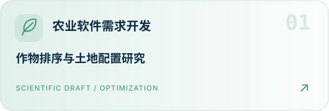
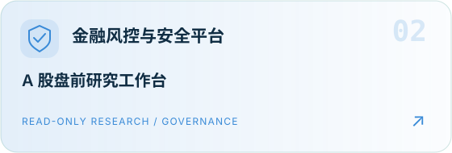
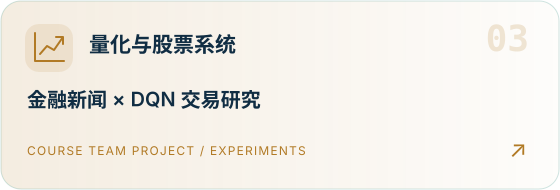
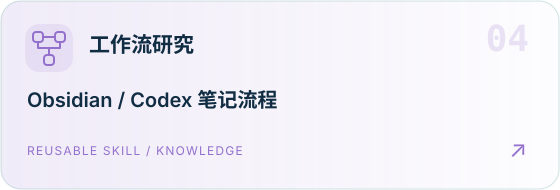
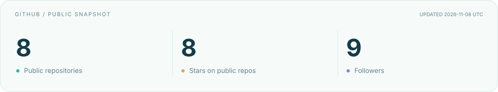

<picture>
  <source media="(prefers-color-scheme: dark)" srcset="./assets/hero-dark.svg" />
  
</picture>

  
  
  
  

<h3 align="center">🌱 农业软件 &nbsp;·&nbsp; 🛡️ 金融风控 &nbsp;·&nbsp; 📈 量化系统 &nbsp;·&nbsp; 🔁 工作流研究</h3>

从业务需求出发，让数据、规则与软件形成可验证的工作流。

  <a href="#user-content-projects">🧭 四个方向</a> &nbsp; / &nbsp;
  <a href="#user-content-toolbox">🛠️ 技术工具</a> &nbsp; / &nbsp;
  <a href="#user-content-activity">⚡ GitHub 动态</a>

我是 **Lu Xinyu**，BNBU 商业分析方向学生。关注农业与金融场景的软件开发，以及工具协作、知识管理与可复用工作流。

## 🧭 四个方向 · Selected Work

  <a href="https://github.com/RyanLu0203/crop-ranking-reversal"><picture><source media="(prefers-color-scheme: dark)" srcset="./assets/project-agri-dark.svg" /></picture></a>
  <a href="https://github.com/RyanLu0203/A_share_premarket_core"><picture><source media="(prefers-color-scheme: dark)" srcset="./assets/project-risk-dark.svg" /></picture></a>
  <a href="https://github.com/RyanLu0203/Fintech-data-scratching-and-analysis"><picture><source media="(prefers-color-scheme: dark)" srcset="./assets/project-quant-dark.svg" /></picture></a>
  <a href="https://github.com/RyanLu0203/Obsidian_lecture_notebook_skill_of_codex"><picture><source media="(prefers-color-scheme: dark)" srcset="./assets/project-workflow-dark.svg" /></picture></a>

<strong>📂 展开项目说明与研究边界</strong>

- **[农业软件需求开发](https://github.com/RyanLu0203/crop-ranking-reversal)** — 从农业生产与经营场景梳理需求，探索评价、资源配置与决策支持。公开的作物排序项目结合理论模型、仿真与官方数据，目前为科研草稿。
- **[金融风控与安全平台开发](https://github.com/RyanLu0203/A_share_premarket_core)** — 关注风险规则、数据质量、权限边界与审计追踪。公开的 A 股盘前项目连接数据采集、时点一致性、证据快照、只读 API 和研究界面。
- **[量化与股票系统开发](https://github.com/RyanLu0203/Fintech-data-scratching-and-analysis)** — 关注数据流程、策略研究与回测评估。公开的课程组项目将金融新闻接入 DQN 实验，展示固定对照、交易记录和结果边界。
- **[工作流研究](https://github.com/RyanLu0203/Obsidian_lecture_notebook_skill_of_codex)** — 探索任务编排、工具协作与知识管理。公开 Skill 将课程 PDF 转为概念化 Obsidian 笔记，通过模板、重点识别与去重复检查支持复用。

## 🛠️ 技术工具 · Toolbox

  <picture><source media="(prefers-color-scheme: dark)" srcset="./assets/stack-dark.svg" /></picture>

<code>需求澄清</code> → <code>数据契约</code> → <code>系统实现</code> → <code>测试验证</code> → <code>持续迭代</code>

## ⚡ GitHub 动态 · Activity

<picture><source media="(prefers-color-scheme: dark)" srcset="./assets/activity-dark.svg" /></picture>

<strong>🐍 贡献图贪吃蛇</strong> &nbsp;·&nbsp; 沿着公开贡献记录前进

<picture><source media="(prefers-color-scheme: dark)" srcset="./assets/snake-dark.svg" /></picture>

贡献动画与公开数据每日自动刷新 · <a href="https://github.com/RyanLu0203/RyanLu0203/actions/workflows/profile-visuals.yml">查看更新状态</a>

<a href="https://github.com/RyanLu0203?tab=repositories">🚀 浏览全部公开仓库</a> &nbsp;·&nbsp; <a href="./assets/THIRD_PARTY_NOTICES.md">素材来源</a>

