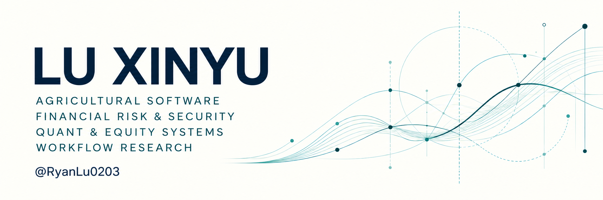

  

  <strong>农业软件需求开发 · 金融风控与安全平台开发 量化与股票系统开发 · 工作流研究</strong>

从业务需求出发，让数据、规则与软件形成可验证的工作流。

  <a href="#focus">开发方向</a> &nbsp;·&nbsp;
  <a href="#projects">公开项目</a> &nbsp;·&nbsp;
  <a href="#approach">工程方法</a>

我是 **Lu Xinyu**，BNBU 商业分析方向学生。目前专注于农业与金融场景的软件开发，以及工具协作与可复用工作流的研究。

## 开发方向

| 方向 | 关注内容 |
| :--- | :--- |
| **01 · 农业软件需求开发** | 从农业生产与经营场景梳理需求，探索作物评价、资源配置和决策支持工具。 |
| **02 · 金融风控与安全平台开发** | 将风险规则、数据质量、权限边界与审计追踪融入平台设计。 |
| **03 · 量化与股票系统开发** | 构建行情与文本数据流程、策略研究工具、回测评估和股票分析工作台。 |
| **04 · 工作流研究** | 探索任务编排、工具协作与知识管理，让复杂工作形成可复用、可检查的流程。 |

## 公开项目

### [作物排序与土地配置研究](https://github.com/RyanLu0203/crop-ranking-reversal)

**农业决策 · 随机优化 · 可复现研究**

研究作物评价排序与土地配置决策之间的关系，结合理论模型、仿真和官方数据分析。当前为科研草稿，可作为理解农业决策软件需求的研究背景。

### [A 股盘前研究工作台](https://github.com/RyanLu0203/A_share_premarket_core)

**数据治理 · 风险诊断 · 证据追踪**

连接数据采集、时点一致性与质量检查、不可变证据快照、只读 API 和研究界面，展示可审计的数据与风险研究流程。当前为只读研究工作台。

### [金融新闻与 DQN 交易研究](https://github.com/RyanLu0203/Fintech-data-scratching-and-analysis)

**金融 NLP · 强化学习 · 回测与可视化**

课程组项目：将金融新闻文本信号接入 DQN 股票交易实验，通过固定对照、交易记录和 Streamlit 界面展示实验结果与证据边界。

### [Obsidian / Codex 学习笔记工作流](https://github.com/RyanLu0203/Obsidian_lecture_notebook_skill_of_codex)

**工作流设计 · 知识管理 · 可复用 Skill**

将课程 PDF 转化为按概念组织的 Obsidian 复习笔记，围绕重点识别、内容生成与去重复检查组织流程，并通过模板与检查清单支持复用。

## 工程方法

**需求澄清 → 数据契约 → 系统实现 → 测试验证 → 持续迭代**

我希望每个项目都能清楚回答：解决什么问题、数据来自哪里、系统如何验证，以及当前能支持哪些结论。

**项目中使用的工具** &nbsp; Python · SQL / SQLite · FastAPI · Next.js · Streamlit · Git

---

[查看全部公开仓库 →](https://github.com/RyanLu0203?tab=repositories)
